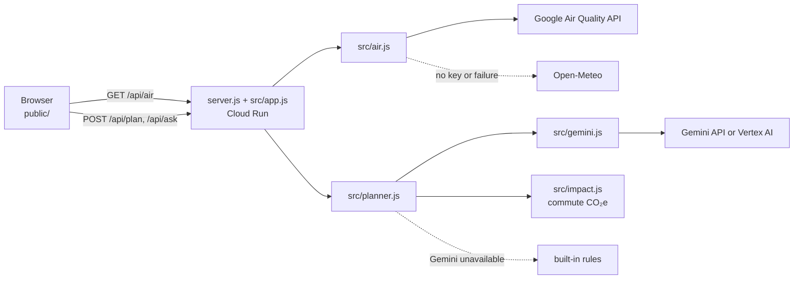

# AirWise: Urban Air Quality Assistant

**PromptWars Virtual, Challenge 06.** AirWise reads the air outside your door, now and for the next 24 hours, and Gemini turns it into a plan for your household: when to go out, how to keep the air at home clean, and what each change saves, in numbers.

> **Live app:** https://airwise-111804601174.asia-south1.run.app

## The problem

In winter smog, families check an AQI number many times a day, but a number doesn't say what to do. Should the kids go to school on foot? When is it safe to air the house? Does a purifier matter more than a mask? Which change actually cuts the pollution the household adds?

## What AirWise does

1. **Live air and a 24-hour forecast** for any city or for your current location. It shows the US AQI computed from PM2.5, how many times over the WHO daily guideline PM2.5 is, the official local index (India's CPCB NAQI, for example), the main pollutant and the data source's health advice. The cleanest and worst three-hour windows of the day are marked.
2. **A plan written by Gemini for this household.** The plan is tailored to who lives there (children, older adults, asthma or heart conditions, pregnancy), the daily commute, outdoor exercise, cooking fuel, whether there's a purifier, and anything else the person types. It has three parts:
   - **Low-emission routine:** the day in time order, built around the cleanest and worst windows.
   - **Indoor air hacks:** what to run, close, stop burning or clean, for this home.
   - **Sustainable swaps:** changes that cut the household's own emissions.

   Every item says what to do, **why** it works, and its **impact**, tagged as less exposure, less pollution, or both.

3. **Impact in numbers.** The commute calculator compares the current commute with realistic alternatives in kg CO₂e a week and a year (and in trees), alongside how much traffic smog each option makes you breathe.
4. **Ask AirWise** follow-up questions ("Can my son play cricket after school?"). Gemini answers from the same live readings.
5. **Eight languages** for plans and answers: English, Hindi, Bengali, Punjabi, Urdu (right-to-left), Marathi, Tamil and Telugu.
6. **Act on it.** Tick the actions you'll do today, and share the plan to the family chat with one tap.
7. **It keeps working when something fails.** Without a Maps key, or if Google's Air Quality API fails, air data comes from Open-Meteo. If Gemini is unavailable, a rule-based plan built from the same data takes its place, and the page says clearly which one you got.

### How it meets the brief

| The brief asks for                 | Where AirWise does it                                                                                                 |
| ---------------------------------- | --------------------------------------------------------------------------------------------------------------------- |
| Low-emission daily routines        | **Low-emission routine**, timed with the forecast's cleanest and worst windows                                        |
| Indoor air quality hacks           | **Indoor air hacks**, matched to purifier, cooking fuel and household                                                 |
| Sustainable alternatives           | **Sustainable swaps** plus the commute comparison chart                                                               |
| Tailored to location               | Live readings and forecast at the user's coordinates, in the place's own time zone                                    |
| Tailored to lifestyle              | Household members, commute (mode, distance, days), exercise, purifier, cooking, notes, language                       |
| Clearly explains the direct impact | Every item has _Why_ and _Impact_ with its type; CO₂e figures are computed in code, never guessed by the model        |
| Responsive, frictionless UI        | One form, sensible defaults, remembered answers, geolocation, 14.2 KB of compressed page code, works from 320 px wide |

## How it works



1. `GET /api/air` geocodes the city (or takes the browser's coordinates). It then fetches current conditions and the hourly forecast in parallel, puts both on the US EPA scale (`src/aqi.js`), and finds the cleanest window between 6 am and 10 pm and the worst window at any time.
2. `POST /api/plan` checks the household profile (`src/profile.js`) and works out the commute numbers (`src/impact.js`). It then asks Gemini for a plan as JSON that must match a response schema.
3. The plan is cleaned up (fields checked, lengths and counts capped) and returned with its source: `gemini` and the model name, or `rules`.

### Prompt design

- **Grounded numbers.** Gemini receives the readings, every forecast hour in local time, the windows, the commute figures and a short list of vetted facts (N95 filtration, HEPA effect, gas-stove NO₂ and so on). It is told to quantify impact only from those, so it never invents a reading or a statistic.
- **Structured output.** `responseMimeType: application/json` with a `responseSchema` (`PLAN_SCHEMA` in `src/gemini.js`) gives the plan a fixed shape: summary, alerts, routine, indoor and swaps. Each item has `time`, `title`, `action`, `why`, `impact` and `impactType`.
- **Tailoring rules.** Sensitive people come first, every item says who it's for, timing follows the windows, and medical advice is limited to "see a doctor".
- **Prompt-injection defence.** Free text is length-capped, and control characters and `<` `>` are stripped, so the text can't close a tag. It reaches Gemini only inside `<household>` or `<question>` tags, which the system instruction says are information, never instructions. Model output is shown with `textContent` only.
- **Fast and resilient.** Thinking is kept low for a waiting user: `MINIMAL` for plans (the numbers come from code) and `LOW` for answers. Models are tried fastest first (`gemini-3.5-flash-lite`, `gemini-3.5-flash`, `gemini-3.8-flash`) when one is busy (429/503), slow (504 or timeout) or unavailable (404), within a 50-second total budget. A model that just failed moves to the back of the line for 2 minutes (6 hours if it is unavailable to the project), so the next request starts with one that is answering.

## Google services

| Service                             | What AirWise uses it for                                                                      |
| ----------------------------------- | --------------------------------------------------------------------------------------------- |
| **Gemini** (`@google/genai`)        | The household plan, as structured JSON output, and follow-up answers                          |
| **Google Air Quality API**          | Current conditions, the official local index, health advice per group and the hourly forecast |
| **Cloud Run**                       | Hosting in Mumbai (`asia-south1`): HTTPS, autoscaling, scales to zero                         |
| **Cloud Build + Artifact Registry** | Builds the container from source on `gcloud run deploy --source .`                            |
| **Secret Manager**                  | Holds the Gemini and Maps keys; Cloud Run injects them at start                               |
| **Vertex AI** (optional)            | Keyless Gemini through the service account                                                    |
| **API Keys API**                    | `deploy.sh` creates a Maps key restricted to the Air Quality API only                         |
| **Cloud Logging**                   | Structured JSON logs with `severity` and `httpRequest`, parsed with no agent or library       |
| **Google Fonts**                    | Bricolage Grotesque and Instrument Sans                                                       |

## Code quality

- **Linted and formatted:** ESLint (`eslint.config.js`: recommended rules plus `eqeqeq`, `no-shadow`, `prefer-const`, `no-param-reassign`, and caps on function length and complexity) and Prettier. `npm run lint` and `npm run format:check` run in CI and must pass.
- **Small single-purpose modules.** The server separates HTTP (`src/app.js`), validation (`src/profile.js`), air data (`src/air.js`), maths (`src/aqi.js`, `src/impact.js`), Gemini (`src/gemini.js`) and planning (`src/planner.js`). The page separates DOM helpers, the air view, the plan view, the ask box and the landing-page effects.
- **Dependency injection instead of globals:** every service takes its collaborators (`fetch`, the Gemini client, the clock, the logger) as arguments, which is how the tests run with no network.
- **One source of truth:** AQI bands and labels live in `src/aqi.js` and travel to the page with each reading; the page keeps no copy.
- **Comments say why, not what,** and the deliberate limits are listed under "Honest limits" below.

## Security

- **Keys stay on the server.** They live in Secret Manager. The Maps key is sent in the `x-goog-api-key` header, never in a URL, and no key reaches the browser.
- **Strict headers on every response.** The Content-Security-Policy allows no inline script or style and no third-party scripts. There's also HSTS, `nosniff`, `X-Frame-Options: DENY`, a strict Referrer-Policy, and a Permissions-Policy that allows only geolocation.
- **Every input is validated.** Numbers are range-checked, choices come from fixed lists, and free text is capped and stripped of control characters and angle brackets. JSON bodies must be under 16 KB with the right `Content-Type`.
- **Rate limits per client IP:** 60 air lookups and 20 AI calls per 10 minutes, with `Retry-After`.
- **Static files are a fixed in-memory list**, so no request path ever reaches the file system.
- **Privacy.** Coordinates are rounded to about 1 km. Logs record the path only, never the query with a location. Nothing about the household is stored on the server.
- **Errors are friendly 4xx/5xx messages**, and stack traces stay in the logs.
- **Least privilege.** The container runs as the unprivileged `node` user. Cloud Run uses a dedicated service account that can read only its own secrets.

## Efficiency

- **Caches:** air readings for 10 minutes per ~1 km cell, place names for 24 hours, plans for 30 minutes per household and reading. Identical requests made at the same moment share one upstream call.
- **Speed:** current conditions and forecast are fetched in parallel. Every upstream call has a timeout, and the low thinking level keeps Gemini quick.
- **Static files** are read once at start-up, precompressed with brotli and gzip, and served with ETags (304 on revalidation).
- **Small footprint:** one runtime dependency (`@google/genai`), no frontend framework and no build step. The whole page is 14.2 KB compressed, fonts aside.

## Accessibility

- **Tested automatically, in a real browser.** `npm run test:e2e` runs axe-core against WCAG 2.2 AA on the landing page and on a full plan, on desktop and phone, and fails the build on any violation. Other browser tests check keyboard-only use (skip link, chips, submitting, focus moving to the results), screen-reader announcements, reduced motion and no sideways scrolling at 320 px.
- **Structure:** semantic landmarks and headings, labels for every control, and grouped choices in `fieldset`s with `legend`s. There's a skip link and a visible focus ring everywhere.
- **Colour is never the only signal.** The AQI band is written out, every forecast hour has screen-reader text ("2 pm: AQI 154, Unhealthy, cleanest window"), and every chart row shows its numbers as text.
- **Live regions** announce progress. Focus moves to the results, and the plan is marked busy while it loads.
- **Comfort:** touch targets are at least 44 px, light and dark themes are both checked for contrast, and `prefers-reduced-motion` turns off all animation.
- **Language:** plans in Indic languages and Urdu get the right `lang`, and Urdu gets `dir="rtl"`.

## Testing

```bash
npm test                # 57 unit and integration tests, Node's built-in runner, no network needed
npm run test:coverage   # the same, failing below 95% of lines (currently 99.9%)
npm run test:e2e        # 20 browser tests: Playwright in Chromium, desktop and phone, with axe accessibility audits
```

- **Unit tests:** every EPA breakpoint edge, forecast windows in the place's time zone, commute maths, input validation, both API response parsers, cache expiry and in-flight sharing, prompt contents and tag isolation, model fallback order, and output cleaning.
- **Integration tests:** the real HTTP server on a random port, covering security headers, compression and ETags, unknown and traversal paths, validation errors, rate limits, upstream failures and the built-in-guidance path.
- **Browser tests** (`e2e/`): the real page against the real server, with the API stubbed from the same fixtures. They cover the full plan flow, WCAG 2.2 AA audits, keyboard-only use, model output that tries to inject HTML (shown as text, never run), the error and retry path, follow-up questions, "remember me" clearing stored answers, 320 px layout and reduced motion.
- **CI:** GitHub Actions runs the syntax check, `npm audit`, the coverage-gated suite and the browser suite on every push. Dependabot proposes dependency and Actions updates weekly.

## Run it locally

Needs Node.js 22 or newer.

```bash
npm install
cp .env.example .env    # then add GEMINI_API_KEY (and MAPS_API_KEY if you have one)
npm start               # http://localhost:8080
```

Without a Gemini key the app still runs, using built-in guidance. Without a Maps key it uses Open-Meteo for air data.

## Deploy to Cloud Run

From the repo root (Cloud Shell works), in a project with billing enabled:

```bash
PROJECT_ID=your-project GEMINI_API_KEY=your-key ./deploy.sh
```

`deploy.sh` does the following:

1. Enables the APIs.
2. Creates a dedicated service account.
3. Creates a Maps key restricted to the Air Quality API.
4. Stores both keys in Secret Manager.
5. Deploys from source to `asia-south1` and prints the URL.

Leave out `GEMINI_API_KEY` to use Vertex AI with the service account instead.

| Variable                                                                     | Purpose                                                                                    |
| ---------------------------------------------------------------------------- | ------------------------------------------------------------------------------------------ |
| `GEMINI_API_KEY`                                                             | Gemini API key (from Secret Manager on Cloud Run)                                          |
| `GOOGLE_GENAI_USE_VERTEXAI`, `GOOGLE_CLOUD_PROJECT`, `GOOGLE_CLOUD_LOCATION` | Use Vertex AI instead of a key                                                             |
| `GEMINI_MODELS`                                                              | Models to try in order (default `gemini-3.5-flash-lite,gemini-3.5-flash,gemini-3.8-flash`) |
| `MAPS_API_KEY`                                                               | Google Maps Platform key with the Air Quality API (optional)                               |
| `PORT`                                                                       | Set by Cloud Run; 8080 locally                                                             |

## Project layout

| Path                         | Job                                                                                                                                             |
| ---------------------------- | ----------------------------------------------------------------------------------------------------------------------------------------------- |
| `server.js`                  | Wires the services together, listens on `$PORT`, shuts down cleanly on `SIGTERM`                                                                |
| `src/app.js`                 | HTTP routes, security headers, rate limits, precompressed static files                                                                          |
| `src/air.js`                 | Google Air Quality API and Open-Meteo clients, geocoding, caching                                                                               |
| `src/aqi.js`                 | PM2.5 to US AQI, bands, WHO multiple, cleanest and worst windows                                                                                |
| `src/impact.js`              | Commute CO₂e and exposure for each mode, and what each swap saves                                                                               |
| `src/profile.js`             | Validates and cleans everything that arrives from the browser                                                                                   |
| `src/gemini.js`              | Prompts, response schema, model chain, output cleaning                                                                                          |
| `src/planner.js`             | Builds the plan, with caching and the built-in fallback plan                                                                                    |
| `src/cache.js`, `src/log.js` | TTL cache with in-flight sharing; structured logs                                                                                               |
| `public/`                    | The page, no framework or build step: `app.js` (planner form), `air-view.js`, `plan-view.js`, `ask.js`, `landing.js`, `dom.js` (shared helpers) |
| `test/`                      | Unit and integration tests with recorded-shape sample data                                                                                      |
| `e2e/`                       | Browser and accessibility tests (Playwright + axe)                                                                                              |

## Honest limits

- The AQI is computed from PM2.5 alone, the main pollutant in winter smog, using hourly readings. The official EPA index uses 24-hour averages, so the number is an "AQI now", not a daily figure.
- The commute emission factors are rough India-typical averages per passenger-km, meant for comparison, not carbon accounting.
- Rate limits and caches live in each Cloud Run instance's memory, which suits this scale. A busy deployment would add Cloud Armor and a shared cache.
- The built-in fallback plan is in English only. Gemini plans and answers follow the chosen language.
- AirWise gives general guidance, not medical advice.
